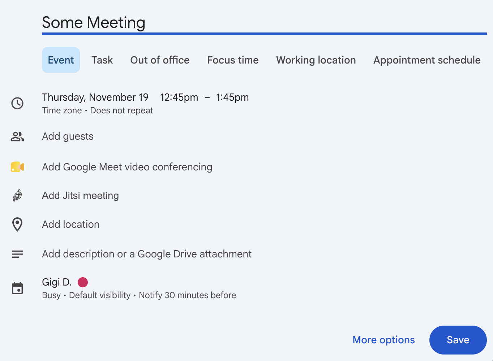
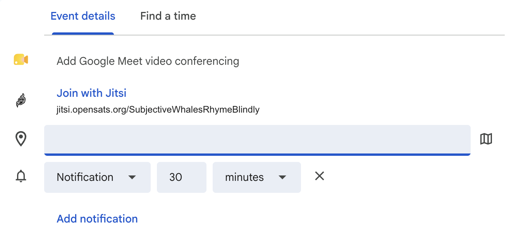
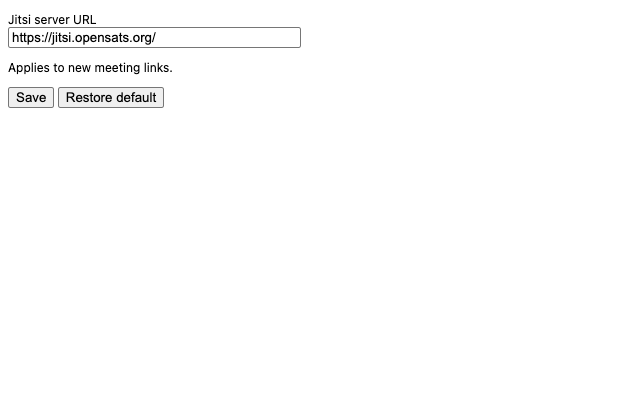

# Jitsi Meetings for Google Calendar

Add a Jitsi room to a Google Calendar invitation. New meetings use [the OpenSats Jitsi server](https://jitsi.opensats.org/) by default. You can choose a different HTTPS server in the extension settings.

## Install in Chrome

The unlisted Chrome Web Store release is pending submission. In the meantime, the team can install directly from GitHub. No terminal or build tools are required.

1. **[Download the extension source ZIP](https://github.com/OpenSats/jitsi-calendar-extension/archive/refs/heads/master.zip)** and unzip it. Move the extracted folder somewhere you’ll keep it, such as Documents.
2. In the Chrome profile you use for work, open `chrome://extensions`. Turn on **Developer mode** in the upper right and click **Load unpacked**.
3. Open the extracted `jitsi-calendar-extension-master` folder and select the **`calendar`** folder inside it. Chrome should show **Jitsi Meetings (custom server)**. If Chrome says the manifest is missing, select the folder that directly contains `manifest.json`.
4. If the original **Jitsi Meetings** extension is installed, turn that copy off. Refresh any open Google Calendar tabs.
5. Create a new event and click **Add Jitsi meeting**. The editor should show **Join with Jitsi** and a room on `jitsi.opensats.org`. The team server is ready to use without opening Settings.

To update an unpacked copy, replace the files in the same installation folder with the latest download, click **Reload** on the extension card, and refresh Calendar. Keeping the folder path preserves the unpacked extension’s identity and settings.

## Schedule a meeting

Create an event and select **Add Jitsi meeting** beneath the Google Meet option. In the quick-create dialog, this opens the full editor and adds the room to your draft. Save the event to share the room link with your guests.



In the event editor, **Join with Jitsi** opens the room shown beneath the button. You can also start a draft from the extension popup with **Create Google Calendar meeting**.



## Choose a server

Open the extension popup, select **Settings**, enter an HTTPS server URL, and click **Save**. New rooms use that server immediately. Existing invitations keep their original room links. **Restore default** switches back to the OpenSats server.



## Development and distribution

The Manifest V3 extension runs directly from `calendar/` without a build step. To prepare the store ZIP from a clean checkout, run the following from the repository root:

```sh
git archive --format=zip --add-file=LICENSE -o jitsi-calendar-extension.zip HEAD:calendar
```

The [store submission notes](CHROMEWEBSTORE.md) cover visibility, permissions, and reviewer instructions. See the [privacy policy](PRIVACY.md) for how the extension handles event fields and settings.

This is an OpenSats fork of [Jitsi’s Jidesha extension](https://github.com/jitsi/jidesha), distributed under the [Apache License 2.0](LICENSE).
